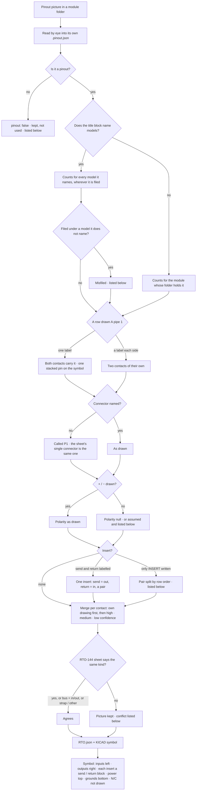

# Pinouts: from the pictures to RTO.json and the KiCad symbol

Every pinout picture of a module (connector layouts, rear views, pin-out pages, plug connections, strapping) is read by eye into `<picture>.pinout.json` beside it (format: [`tools/pinout_schema.md`](../../tools/pinout_schema.md)). [`tools/pinout_build.py`](../../tools/pinout_build.py) merges them into each module's `RTO.json` and `KICAD/<code>.kicad_sym`, and writes this page.

**117 pictures read · 75 modules built · 3065 contacts · 31 inserts · 60 things to check**

## Decision tree

## Rules

- **Which module a picture belongs to.** The models named in its title block (`applies_to`), wherever the file sits. A picture whose title names none counts for the folder it is in. A picture filed under a model it does not name is listed as misfiled; it still counts for the models it names.
- **Two-sided edge connectors.** A row drawn "A | 1" with one label: both contacts carry it, and the symbol shows them as one stacked pin (the letter hidden under the number). A row with a label on each side: two contacts of their own.
- **Connector names.** A drawing that names no connector is read as P1. When the RTO-144 sheet has a single connector of another name (often P2) it is the same connector.
- **Polarity.** Only as drawn. Most WBS rear views mark no + / −: polarity is null and the port's contacts are keyed a / b. A reading that assumed polarity says so in its notes and is listed below.
- **Inserts.** Always a pair: the send is the module's output to the outboard gear (`insert_send`), the return its input back (`insert_return`). Insert out / in, send / return, pre-fader out / fader return, EQ / compressor inserts count. Where a drawing writes only "INSERT" on several contacts the split into send and return is a guess from row order, listed below.
- **Straps.** Jumpers and strap options from the picture, plus the RTO-144 sheet's frame straps. A strap rides on a contact that also carries a signal, so it never disagrees with it.
- **Merging readings.** Per contact: a module's own drawing before a variant's, then high before medium before low confidence. A second reading of another kind is a conflict.
- **The RTO-144 sheet.** A check only, never the source. Same kind = agrees (a bus contact is fed or read, so bus matches in and out; "other" fits anything). Otherwise the picture is kept and the disagreement listed.
- **The symbol.** Inputs, control inputs, straps and others on the left; outputs and control outputs on the right; each insert a dashed send / return block of its own under the outputs; power on top; grounds, chassis and loose shields at the bottom; N/C contacts not drawn. The old symbol's properties (title, category, year …) are kept; no ";;" comments (KiCad 9 will not load them).

## To check

Where a reading had to guess, or two sources disagree. Each module's `RTO.json` carries its own list (`to_check`).

### M124

- **polarity assumed**: 2 contacts given + / − that the drawing does not mark (e.g. P1-4 INPUT HIGH (600 OHM: +)) (M124: 1968 - 124-09-001 - CONNECTOR WIRING - DRN C.S. O'CONNELL - ISS 1.jpg)
- **polarity assumed**: 2 contacts given + / − that the drawing does not mark (e.g. P1-4 INPUT HIGH (600 OHM: +)) (M124: 1968 - 124-09-001 - CONNECTOR WIRING - DRN C.S. O'CONNELL.jpg)

### M166

- **disagree** P1-12: kept - (SUPPLY RETURN) (power); RTO-144 sheet says GND (ground)

### M402

- **insert guessed**: which of B/M is the source and which the destination is inferred, not labelled. (M402: 1968 - 402-09-001 - & 404 EQUALIZER PLUG CONNECTIONS - DRN C.S. O'CONNELL - ISS 2.jpg)
- **insert guessed**: which of B/M is the source and which the destination is inferred, not labelled. (M402: 1968 - 402-09-001 - & 404 EQUALIZER PLUG CONNECTIONS - DRN C.S. O'CONNELL.jpg)

### M404

- **insert guessed**: which of B/M is the source and which the destination is inferred, not labelled. (M402: 1968 - 402-09-001 - & 404 EQUALIZER PLUG CONNECTIONS - DRN C.S. O'CONNELL - ISS 2.jpg)
- **insert guessed**: which of B/M is the source and which the destination is inferred, not labelled. (M402: 1968 - 402-09-001 - & 404 EQUALIZER PLUG CONNECTIONS - DRN C.S. O'CONNELL.jpg)

### M450A

- **disagree** P1-3: kept SUMMING INPUT (in); RTO-144 sheet says N/A ON M450A (nc)
- **disagree** P1-5: kept SUMMING INPUT (in); RTO-144 sheet says N/A ON M450A (nc)

### M451

- **disagree** P1-18: kept OUT 4 (out); RTO-144 sheet says GND (ground)
- **disagree** P1-Y: kept N/C (nc); RTO-144 sheet says VCC-LOGIC (power)

### M452

- **disagree** P1-18: kept SWITCHED OUTPUT CTL (control_in); RTO-144 sheet says GND (ground)
- **disagree** P1-Y: kept N/C (nc); RTO-144 sheet says VCC-LOGIC (power)

### M453A

- **disagree** P1-18: kept N/C (nc); RTO-144 sheet says GND (ground)
- **disagree** P1-19: kept N/C (nc); RTO-144 sheet says VEE-AUDIO (power)

### M455

- **polarity assumed**: 10 contacts given + / − that the drawing does not mark (e.g. P1-A EXT METER IN +) (M455: 1974 - M455 - 455-04-002 - REELN CONNECTOR REAR VIEW CALE OLS.jpg)

### M460A

- **insert guessed**: what exactly sits between PRE OUT / BOOSTER IN and CH ON OUT / CH ON IN is not stated - insert reading is an interpretation preamp output out and booster amp input back: the insert point between preamp and booster (e.g. (M460A: 1977 - M460A - 460-04-004 - KYYS CONNECTOR REAR VIEW.jpg)

### M460L

- **insert guessed**: Whether PRE OUT/BOOSTER IN are normalled on the module is not shown PRE OUT (Z/22) to BOOSTER IN (W/19) is read as the preamp-to-booster patch point (insert). (M460L: 1974 - M460L - 460-04-622 - INPUT MODULE CONNECTOR REAR VIEW.jpg)

### M461

- **disagree** P1-11: kept BOOSTER AMP (insert_send); RTO-144 sheet says Fader Return + (in)
- **disagree** P1-12: kept CH ON (insert_return); RTO-144 sheet says CHON OUT - OUT + (out)
- **disagree** P1-13: kept PHASE SWITCH (insert_send); RTO-144 sheet says Insert Return + (in)
- **disagree** P1-14: kept OUTPUT AMP (insert_return); RTO-144 sheet says Insert Send + (out)
- **disagree** P1-M: kept BOOSTER AMP (insert_send); RTO-144 sheet says Fader Return - (in)
- **disagree** P1-N: kept CH ON (insert_return); RTO-144 sheet says CHON OUT - OUT - (out)
- **disagree** P1-P: kept PHASE SWITCH (insert_send); RTO-144 sheet says Insert Return - (in)
- **disagree** P1-R: kept OUTPUT AMP (insert_return); RTO-144 sheet says Insert Send - (out)

### M463J

- **disagree** P1-W: kept M1 CONTROL (control_out); M463AC/PINOUTS/1986 - M463AC - 463-04-009 - CONNECTOR REAR VIEW.pinout.json says M1 CONTROL (control_in)
- **disagree** P1-X: kept M2 CONTROL (control_out); M463AC/PINOUTS/1986 - M463AC - 463-04-009 - CONNECTOR REAR VIEW.pinout.json says M2 CONTROL (control_in)
- **insert guessed**: Direction (in/out) of M1 CTL and M2 CTL not stated FADER OUT (K/9) and FADER IN (S/15): fader send/return. (M463J: 1972 - M463J - 463-04-009 - CONNECTOR REAR VIEW HALE.jpg)

### M465

- **disagree** REV SEND OUT 2: kept insert port; inserts says no partner (send / return) named
- **insert guessed**: 'P1' assumed REV SEND OUT to the reverb device, RETURN IN back from it; (M465: 1974 - M465 - 465-04-003 - CONNECTOR REAR VIEW CALE.jpg)

### M466

- **disagree** P1-15: kept OUTPUT (out); RTO-144 sheet says Dynamics-OUT-LEFT + (in)
- **disagree** P1-16: kept OUTPUT (out); RTO-144 sheet says Dynamics-OUT-LEFT - (in)

### M467

- **disagree** P1-15: kept OUTPUT (out); RTO-144 sheet says Dynamics-OUT-LEFT + (in)
- **disagree** P1-16: kept OUTPUT (out); RTO-144 sheet says Dynamics-OUT-LEFT - (in)

### M470A

- **disagree** P2-5: kept ATT OUT - (out); RTO-144 sheet says FADER-RETURN + (in)
- **disagree** P2-E: kept ATT OUT + (out); RTO-144 sheet says FADER-RETURN - (in)
- **polarity assumed**: 42 contacts given + / − that the drawing does not mark (e.g. P1-A MASTER 2 OUT +) (M470A: 1977 - M470A - 470-04-005 - FIMISH NPUT MODULE CONNECTOR REAR VIEW.jpg)

### M470C

- **disagree** P2-5: kept ATT OUT (out); RTO-144 sheet says FADER-RETURN + (in)
- **disagree** P2-E: kept ATT OUT (out); RTO-144 sheet says FADER-RETURN - (in)

### M470E

- **disagree** P2-5: kept ATT OUT (out); RTO-144 sheet says FADER-RETURN + (in)
- **disagree** P2-E: kept ATT OUT (out); RTO-144 sheet says FADER-RETURN - (in)

### M472

- **polarity assumed**: 2 contacts given + / − that the drawing does not mark (e.g. P1-4 INPUT) (M472: 1977 - M472 - 472-04-002 - CONNECTOR REAR VIEW CALE.jpg)
- **polarity assumed**: 2 contacts given + / − that the drawing does not mark (e.g. P1-4 INPUT) (M472: 1977 - M472 - Pin Out.jpg)

### M473A

- **disagree** P1-J: kept ATT OUT (out); RTO-144 sheet says Insert Return - (in)
- **disagree** P1-R: kept SUB ON OUT (control_out); RTO-144 sheet says Insert Return + (in)

### M477

- **disagree** P1-J: kept ATT OUT (out); RTO-144 sheet says Insert Return - (in)
- **disagree** P1-R: kept OUTPUT AMP OUT (out); RTO-144 sheet says Insert Return + (in)

### M490A

- **insert guessed**: Insert send vs return assignment within the four INSERT rows is not drawn Checker's signature (looks like 'Relle') Issue/date revision columns empty (M490A: 1978 - M490A - 021 - Pin Out.jpg)

### M490D

- **insert guessed**: Which of the eight INSERT contacts (P2-E,F,H,J,5,6,7,8) are send vs return, and their polarity / channel, is not shown. (M490D: 1978 - M490D - pinout-490-04-005 (2).pdf)
- **insert guessed**: Which of the eight INSERT contacts (P2-E,F,H,J,5,6,7,8) are send vs return, and their polarity / channel, is not shown. (M490D: 1978 - M490D - pinout-490-04-005.pdf)

### M490F

- **insert guessed**: recorded as a send/return pair per channel, but the send/return assignment is assumed from row order, not drawn. (M490F: 1978 - M490F - 490-04-007 - CONNECTOR REAR VIEW.jpg)

### M521

- **polarity assumed**: 16 contacts given + / − that the drawing does not mark (e.g. P2-A INSERT OUT L +) (M521: 1985 - M521 - Sterio Input Module Connector Layout.jpg)

### M523

- **insert guessed**: INSERT PREFADE L/R is a third insert-labelled point, recorded as an output (kind out) because the drawing does not say whether it is a pre-fade send or a second return. (M523: 1985 - M523 - ST Series - Stereo Submaster Module - 013 - p1 Connector pinout.jpg)

### M600

- **polarity assumed**: 2 contacts given + / − that the drawing does not mark (e.g. P1-16 INPUT -) (M600: 1970 - M600 - 600-02-011 - AUDIO AMPLIFIER OUTPUT STRAPPING SCHEMATIC.jpg)
- **polarity assumed**: 2 contacts given + / − that the drawing does not mark (e.g. P1-16 INPUT -) (M600: 19xx - 600-02-011 - AUDIO AMPLIFIER OUTPUT STRAPPING SCHEMATIC - ISS 3.jpg)

### M701

- **polarity assumed**: 4 contacts given + / − that the drawing does not mark (e.g. P1-21 SPEAKER OUTPUT) (M703: 1977 - M703 - B 703-02-001 - INTERCOM 701, 702, 703 INPUT OUTPUT AMP PIN CONNECTIONS & STRAPPING.jpg)

### M702

- **polarity assumed**: 4 contacts given + / − that the drawing does not mark (e.g. P1-21 SPEAKER OUTPUT) (M703: 1977 - M703 - B 703-02-001 - INTERCOM 701, 702, 703 INPUT OUTPUT AMP PIN CONNECTIONS & STRAPPING.jpg)

### M703

- **polarity assumed**: 4 contacts given + / − that the drawing does not mark (e.g. P1-21 SPEAKER OUTPUT) (M703: 1977 - M703 - B 703-02-001 - INTERCOM 701, 702, 703 INPUT OUTPUT AMP PIN CONNECTIONS & STRAPPING.jpg)

### M901CY

- **polarity assumed**: 21 contacts given + / − that the drawing does not mark (e.g. P1-2 PGM 1 MUSIC OUT LEFT) (M901CY: 1994 - M901CY - CONNECTOR LAYOUT.jpg)

## Misfiled pictures

Filed under a model their title block does not name; they count for the models they name.

| Folder | Picture | Title names |
|---|---|---|
| M402 | 1970 - 402-02-011 - M402A AND M404A EQUALIZER PLUG CONNECTIONS - DRN DJG - ISS 3.jpg | M402A, M404A |
| M406 | 1970 - 406-02-011 - M406B COMPRESSOR PLUG CONNECTIONS - DRN DJG - ISS 2 (2).jpg | M406B |
| M406 | 1970 - 406-02-011 - M406B COMPRESSOR PLUG CONNECTIONS - DRN DJG - ISS 2.jpg | M406B |
| M406 | 1970 - M406 - B 406-02-011 - M406B COMPRESSOR - PLUG CONNECTIONS.jpg | M406B |
| M461M | 1975 - M461M - WBS 461M Pinouts.jpg | M461 |
| M463AC | 1986 - M463AC - 463-04-009 - CONNECTOR REAR VIEW.jpg | M463J |
| M464 | 1976 - M464 - P4 - Pin Out.jpg | M462, M462A, M462B |
| M472 | 1977 - M472 - Pin Out (2).jpg | M462, M462A, M462B |
| M484 | 1975 - 484-04-002 - SUMMING AMPLIFIER CONNECTOR REAR VIEW - DRN DM - ISS 1.jpg | M484A |
| M484 | 1975 - M484 - 484-04-002 - CONNECTOR REAR VIEW.jpg | M484A |
| M522 | 19xx - M522 - A B - P14 - Pinouts.jpg | M522B, M522C |
| M621 | 1973 - 621-02-004 - M621T OUTPUT TRANSFORMER CONNECTIONS - DRN BJ - ISS 1.jpg | M621T |
| M621 | 1973 - 621-02-004 - OUTPUT TRANSFORMER CONNECTIONS (4 OHM 16 OHM 150 OHM; title block cut - DRN BJ.jpg | M621T |
| M712 | 1979 - 712-02-102 - M712B INTERCOM MATRIX AMPLIFIER CONNECTION OF MULTIPLE MODULES - DRN MRW - ENG MRW - ISS 1.jpg | M712B |

## Not pinouts

Read and kept (`"pinout": false`), not used.

| Folder | Picture | What it is |
|---|---|---|
| M463 | 1972 - M463 - 4136-06-010 - COMPONENT NQTES LEGEND CONNECTOR PIN MOUNTED.jpg | Not a pinout: left half of a PCB component-side assembly drawing (relay K1 V23030-A2021-A104, TIP30B/TIP29B on heat sink A460-03-014, switches SW11-SW14 and SW22-SW25, Z1-Z4, E-numbered stand-off pins) |
| M463K | 1974 - M463K - 461-03-015 - NOTES LEGEND CONNECTOR PIN MOUNTED.jpg | Not a pinout: left half of a PCB component layout ('COMPONENT SI[DE]') showing Q1-Q6 (TIP 29B/30B on heat sink A460-03-014, PN3645/PN3569), relay K1 V23030-A2021-A104, R142 5k trimmer, Z1-Z4, switch pads SW13/14/19/22-25, wiring pads and stand-offs (3E1-3E6, 4E1-4E7) |
| M463L | 1974 - M463L - 461-03-015 - COMPONENT SIDF NOTES LEGEND CONNECTOR PIN MOUNTED.jpg | Not a pinout: PCB component-side assembly layout (K1 V23030-A2021-A104 relay, TIP30B/TIP29B on heat sink A460-03-014, SW11-SW14, SW19-SW25 wiring pads, Z1-Z4) |
| M463LA | 1974 - M463LA - 4-136-06-023 - COMPONENT SIDE NOTES LEGEND CONNECTOR PIN MOUNTED.jpg | Not a pinout: PCB component-side assembly drawing (PCB No 4-136) showing parts K1 V23030-A2021-A104 relay, TIP30B/TIP29B on heat sink A460-03-014, Z1-Z4 ICs (all LM201N), switches SW11-SW14, SW22-SW25, wiring pads and standoff pins 3E1-3E6, 4E1-4E7 |

## Modules with pictures but no pinout of their own

Their pictures name other models only; RTO.json and the symbol stay as they were.

| Module | Its pictures name |
|---|---|
| M406 | M406B |
| M461M | M461 |
| M463AC | M463J |
| M463K | - |
| M463LA | - |
| M484 | M484A |
| M522 | M522B, M522C |
| M712 | M712B |

---
Archive: Anthony Peter Kuzub · [WBSps.ca](https://WBSps.ca) · [WBSps.Kuzub.com](https://WBSps.Kuzub.com)
